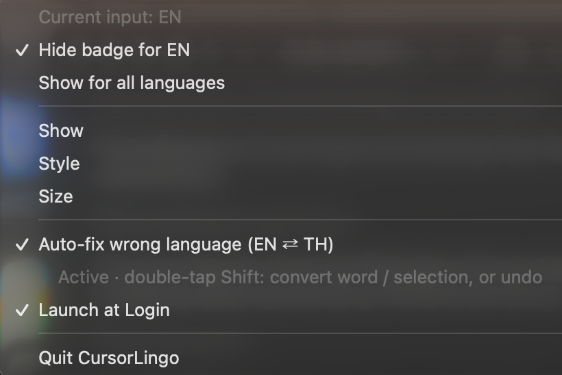

<p align="center">
  
</p>

<h1 align="center">CursorLingo</h1>

<p align="center">
  <b>English</b> · <a href="README.th.md">ภาษาไทย</a>
</p>

<p align="center">
  See your current keyboard language <b>right at the mouse pointer</b>, so you never type a whole sentence in the wrong language again.<br>
  Tiny, native, and private. Runs on <b>macOS</b> and <b>Windows</b>.
</p>

<p align="center">
  
  <br><sub><a href="assets/demo.mp4">▶ Watch in HD (MP4)</a></sub>
</p>

<p align="center">
  
</p>

## Features

- **Badge at the pointer** shows `EN`, `TH`, `JA`, `ZH`, `KO`… for *any* input language, each in its own color.
- **4 styles** (Color · Light · Dark · Dot) and **3 sizes**.
- **Show mode:** *Always*, or *Only when switching* (pops up for about a second, then fades out).
- **Hide per language.** For example, show the badge only when you're *not* in English.
- **Presentation tools** for screen sharing and recordings. Use them alone or together; every click sends out a ripple in the current language's color.
  - **Spotlight** (⌃⌥H on macOS, Ctrl+Alt+H on Windows), after [cursor-highlight](https://github.com/Hazyzh/cursor-highlight): the screen dims except for a circle around the pointer with a turning rainbow ring. It stays click-through, so you keep working.
  - **Zoom** (⌃⌥Z / Ctrl+Alt+Z): the circle magnifies what is under the pointer. ⌃⌥= and ⌃⌥− (Ctrl+Alt+= / −) zoom in and out, from 1.5× to 8×.
  - **Draw on screen** (⌃⌥D / Ctrl+Alt+D): draw with the mouse; ⌘Z / Ctrl+Z takes back the last stroke. While drawing, clicks go to the pen.
  - Hold ⌃⌥ / Ctrl+Alt and scroll to resize the circle. Esc stops drawing first, then turns everything off.
  - Change the three tools' shortcuts in **Presentation → Shortcuts…**.
  - Spotlight and drawing need no permissions, and neither does zoom on Windows. Zoom on macOS needs **Screen Recording**, because it has to see the screen; macOS asks the first time you turn zoom on, and recent versions ask again every so often, as they do for every app that records the screen.
- **Remember language per app (optional).** Each app gets back the layout you last used in it, e.g. English in your editor and Thai in your chat app.
- **Launch at login / Start with Windows**, toggled from the menu.
- **English or Thai menus**, following your system language, or picked under *Language / ภาษา*.
- **Click-through.** The badge never steals clicks or focus.
- **Auto-fix wrong language (optional, off by default).** Typed `l;ylfu;yoouhgik` instead of `สวัสดีวันนี้เรา`, or `ะ้รห` instead of `this`? CursorLingo re-types the word and switches the layout for you. English ⇄ Thai. See [Auto-fix](#auto-fix-wrong-language).
- **Private.** No network, no telemetry. Keystrokes are only observed if you turn Auto-fix on, and then only the current and the last word are kept in memory, plus the personal word list you teach it with double Shift.
- **Light on resources.** It's event-driven, with no polling timers on macOS.

|                  | macOS                                  | Windows                                        |
|------------------|----------------------------------------|------------------------------------------------|
| Tech             | Swift + AppKit, single file            | C++ / Win32 + GDI, single file, static exe     |
| Pointer tracking | `NSEvent` global mouse monitor         | Low-level mouse hook (coalesced)               |
| Language source  | `kTISNotifySelectedKeyboardInputSourceChanged` | `GetKeyboardLayout` of focused thread   |
| Memory           | ~15 MB physical footprint              | ~1–2 MB working set                            |
| Idle CPU         | 0 % (no wake-ups)                      | ~0 % (one coalesced 200 ms check)              |
| Settings         | Menu-bar icon                          | Tray icon (shows the current language)         |

The Windows tray icon itself shows the current language code. The badge also hides automatically while a full-screen app or game is in front.

## Install

### macOS (12 Monterey or later, Apple Silicon and Intel)

Download `CursorLingo-macOS.zip` from [Releases](https://github.com/kittipongint/cursor-lingo/releases), unzip it, move **CursorLingo.app** to **Applications**, and double-click it. Releases from v1.1.4 on are signed with a Developer ID and notarized by Apple, so they open without warnings.

The badge needs no permissions. Input Monitoring and Accessibility are only needed for [Auto-fix](#turn-on-auto-fix-on-macos), and Screen Recording only for the presentation zoom.

**Or build from source** (needs the Xcode Command Line Tools):

```bash
git clone https://github.com/kittipongint/cursor-lingo.git && cd cursor-lingo && ./install.sh
```

If your keychain has a *Developer ID Application* certificate, `install.sh` signs with it, so macOS keeps CursorLingo's permissions across rebuilds. To notarize a build yourself, see `macos/notarize.sh`.

#### Turn on Auto-fix on macOS

1. In the menu-bar menu, open **Fix Wrong Language (EN ⇄ TH)** and choose **Automatic** (or **Double Shift Only**). The line under it shows what is still missing.
2. **Input Monitoring:** allow CursorLingo when macOS asks, or click **Open Privacy Settings…** in the menu and turn CursorLingo on under **Privacy & Security → Input Monitoring**.
3. **Accessibility:** do the same under **Privacy & Security → Accessibility**. If CursorLingo is not listed, click **+** and choose **Applications → CursorLingo**.
4. **Quit CursorLingo and open it again.** The app reads these permissions when it starts.
5. The line under Fix Wrong Language should now say **Active**. Test it: on the English layout type `l;ylfu` and press Space; it becomes **สวัสดี**.

   

You only do this once: updates keep the permissions.

**Upgrading from v1.1.3 or older?** Those builds were only ad-hoc signed, so macOS treats v1.1.4 as a new app. Grant the permissions one last time: in both **Input Monitoring** and **Accessibility**, select the old CursorLingo, click **−**, add the new one with **+**, and reopen the app. If it still says *Needs … permission*, clear the old entries and let macOS ask again:

```bash
tccutil reset Accessibility io.github.cursorlingo
```

```bash
tccutil reset ListenEvent io.github.cursorlingo
```

Then reopen CursorLingo, set Fix Wrong Language to **Off** and back on. (Builds from source signed ad-hoc behave like the old releases: macOS asks again after every rebuild.)

### Windows 10 / 11 (x64)

From [Releases](https://github.com/kittipongint/cursor-lingo/releases), pick one. **Neither needs administrator rights.**

- **Installer (recommended):** `CursorLingo-Windows-x64-Setup.exe`. Installs for your user only, to `%LOCALAPPDATA%\Programs\CursorLingo` (like VS Code's user installer), adds a Start Menu shortcut, can start CursorLingo with Windows, and appears in **Settings → Apps → Installed apps**, where you can uninstall it. Uninstalling also removes its settings.
- **Portable:** `CursorLingo-Windows-x64-Portable.zip`. Unzip anywhere (Desktop, USB stick, ...) and run `CursorLingo.exe`. Settings stay in the `CursorLingo.ini` next to it, so the whole folder moves with you. To remove it, quit and delete the folder.

Settings are plain files (`%APPDATA%\CursorLingo` for the installed app, the folder itself for the portable one), and *Start with Windows* is a shortcut in your Startup folder. The only registry entry is the one the installer adds so Windows lists the app under Installed apps; the portable version writes none.

**SmartScreen warning.** The files are not code-signed, so Windows may show *"Windows protected your PC"* the first time. Either:

- **Before opening:** right-click the downloaded file → **Properties** → tick **Unblock** → **OK**.
- **Or when it appears:** click **More info → Run anyway**. Windows remembers this for that file.

Each new version is a new file to SmartScreen, so expect this once per update.

**Or build from source** with Visual Studio 2022 or Build Tools + CMake:

```bat
windows\build.bat
```

To build the installer too, install [Inno Setup 6](https://jrsoftware.org/isinfo.php) and run `iscc windows\CursorLingo.iss` (it writes `build\CursorLingo-Windows-x64-Setup.exe`). Without it, `windows\install.ps1` does a scripted per-user install of a build.

You can also cross-compile with MinGW-w64:

```bash
x86_64-w64-mingw32-windres windows/CursorLingo.rc -O coff -o res.o
x86_64-w64-mingw32-g++ -std=c++17 -Os -municode -mwindows -static windows/CursorLingo.cpp res.o \
  -o CursorLingo.exe -luser32 -lgdi32 -lshell32 -ladvapi32 -lshcore -lwtsapi32 -lole32 -luuid -s
```

## Auto-fix wrong language

<p align="center">
  
</p>

<p align="center"><sub>
  ① Thai typed on the English layout → fixed while typing &nbsp;·&nbsp;
  ② English typed on the Thai layout → fixed at Space &nbsp;·&nbsp;
  ③ <code>muj</code> + double Shift → ที่ &nbsp;·&nbsp;
  ④ select a line + double Shift → converted
</sub></p>

In the menu, set **Fix Wrong Language (EN ⇄ TH)** to **Automatic**. When you finish a word with Space, and it looks like gibberish in the current layout but like a real word in the other one, CursorLingo erases it, types it again from the same keys, and switches the layout so you can keep going. Long Thai runs typed without spaces are fixed after a few characters.

**Choose how much it does.** **Fix Wrong Language (EN ⇄ TH)** is a single menu with three choices:

- **Off**: nothing is watched; only the badge runs.
- **Double Shift Only**: nothing changes by itself. Words and selections are converted only when you double-tap Shift.
- **Automatic**: words are fixed as you type, and double Shift still converts or undoes.

In the same menu, **In Code Editors: Double Shift Only** (on by default) applies to Automatic. In VS Code, Cursor, Zed, Xcode, JetBrains IDEs, Sublime Text, Visual Studio and similar editors, variable names and keywords can look like gibberish, so words are only converted when you ask.

**Personal word list.** Every word you convert or undo with double Shift is remembered, on this computer only, so you teach CursorLingo your own words, names and slang. The menu shows how many it has learned and can forget them all. Words typed without double Shift are never saved.

**Remember language per app** (in the menu, off by default) switches to the layout you last used in an app whenever it comes to the front. It needs no special permission and works without Auto-fix.

It keeps working after sleep, closing the lid, locking the screen or switching users: CursorLingo re-arms its keyboard listener and forgets the half-typed word, so nothing stale is "fixed" after you wake the computer.

**Double-tap Shift** to convert by hand, or to undo:

- Right after an automatic fix, double Shift puts the word back the way you typed it, switches the layout back, and **remembers to leave that word alone**.
- On any other word (the one you're typing, or the last one), double Shift converts it to the other layout. Words that are also real words in the other language, such as `ที่` = `muj` or `ทำไม` = `mew`, are not fixed automatically at first, so this is the quick way to fix them. **CursorLingo learns from it:** the next time you type that word in that layout, it is fixed by itself.
- **Select text and double-tap Shift** to convert the whole selection (several words or lines). Each character is read back through the other layout; the direction follows the script that dominates (mostly Thai → English, otherwise English → Thai), and anything that isn't on the keyboard (spaces, new lines, emoji) is kept. On macOS the selection is read through Accessibility; apps that don't expose it, and all Windows apps, use a quick copy/paste, after which your clipboard is restored. Terminals are skipped.
- Without a selection it works on the current or last word only, and only if you haven't clicked, used a shortcut or switched apps since. It doesn't add entries to the app's undo history. Note that JetBrains IDEs also use double Shift (Search Everywhere).

**How it decides.** A key press is a *physical key*, and every physical key produces one character in each layout. A word typed in the wrong layout is therefore the right text seen through the wrong key map. For each word, CursorLingo computes both readings and converts only when:

1. the reading on screen is implausible for its language, and
2. the other reading is plausible for its language.

*English plausibility* uses a letter-trigram model (real words are cheap; Thai typed on a Latin layout is full of impossible sequences and punctuation keys such as `; ' , .` inside words). *Thai plausibility* uses Thai orthography: a word can't start with a tone mark or trailing vowel, vowels sit on consonants, a leading vowel needs a consonant after it, and so on. English typed on the Thai layout breaks these rules almost immediately. Very short words, numbers, paths, URLs, e-mail addresses and code-like words are never touched, because precision matters more than recall.

On a sample of real English and Thai words, correct text was wrongly changed in fewer than 1 in 1,000 cases, and about 80 % of wrong-layout words were fixed. Words it is unsure about are left alone.

**Privacy and permissions.**
- Off by default. The keyboard hook / event tap only exists while the option is on.
- Only the current and the last word are kept, in memory. The one thing saved is your personal word list (words you converted or undid with double Shift), in the app's preferences on this computer; *Forget learned words* clears it. Nothing is logged or sent anywhere.
- macOS needs **Input Monitoring** and **Accessibility** (see [Turn on Auto-fix on macOS](#turn-on-auto-fix-on-macos)). Secure input (password fields) and Terminal apps are skipped.
- Windows needs no special rights, but cannot see windows running as administrator. Classic password boxes and consoles are skipped.
- Only the stock US-English and Thai (Kedmanee) layouts are supported; other layouts are left alone.

## Usage

Click the menu-bar icon (macOS) or right-click the tray icon (Windows) to:

- see the current input language,
- hide the badge for the current language, or show it for all languages again,
- choose **Show**, **Style** and **Size**,
- set **Fix Wrong Language (EN ⇄ TH)** to Off, Double Shift Only or Automatic, toggle **In Code Editors: Double Shift Only**, and forget learned words,
- toggle the **Presentation** tools: Spotlight, Zoom and Draw on Screen (their shortcuts work from anywhere, and **Shortcuts…** changes them),
- toggle **Remember Language per App**,
- toggle **Launch at Login** / **Start with Windows**,
- choose the menu's **Language / ภาษา**: English, Thai, or the system's language (the default),
- **Report a Wrong Fix or Bug…** (opens the GitHub issue form; nothing you typed is attached),
- quit.

## Uninstall

- **macOS:** `./uninstall.sh`, or quit the app and delete it. Turn off *Launch at Login* first.
- **Windows:** installed: **Settings → Apps → Installed apps → CursorLingo → Uninstall** (removes its settings too). Portable: untick *Start with Windows*, quit, and delete the folder.

## Project layout

```
core/      layoutfix.h (wrong-layout detector, shared) · en_model.inc (generated) · C interface for Swift
macos/     CursorLingo.swift · Info.plist · build.sh (universal binary)
windows/   CursorLingo.cpp · CursorLingo.rc · manifest · CMakeLists.txt · build.bat · CursorLingo.iss (installer) · msix/ (Microsoft Store package) · install.ps1
tests/     layoutfix_test.cpp · cases.tsv (real-world fix / keep cases; add yours)
assets/    AppIcon.png / .icns / .ico, screenshots
tools/     make-icon.swift (vector icon generator) · make-demo.swift (README animation) · ai-icon.sh (optional AI icon) · gen-en-model.py
```

The icon is drawn in code by `tools/make-icon.swift`, and the demo animation by `tools/make-demo.swift` (`swiftc -O tools/make-demo.swift -o /tmp/make-demo && /tmp/make-demo`). To try an AI-generated icon, run `OPENAI_API_KEY=… ./tools/ai-icon.sh`.

## Privacy

CursorLingo collects nothing and makes no network connections. The full policy is in [PRIVACY.md](PRIVACY.md).

## Contributing

Found a word that was fixed wrongly, or not fixed? That's the most useful report there is: use the [wrong-fix form](https://github.com/kittipongint/cursor-lingo/issues/new/choose), or add a line to [`tests/cases.tsv`](tests/cases.tsv) and open a pull request. [CONTRIBUTING.md](CONTRIBUTING.md) explains how to test a word, build both apps, and the privacy rules every change follows. Security or privacy problems: see [SECURITY.md](SECURITY.md).

## Related projects

- **[RightLang](http://blog.rightlang.com/)**, a long-standing Thai tool for fixing text typed in the wrong layout.

## License

[MIT](LICENSE)
