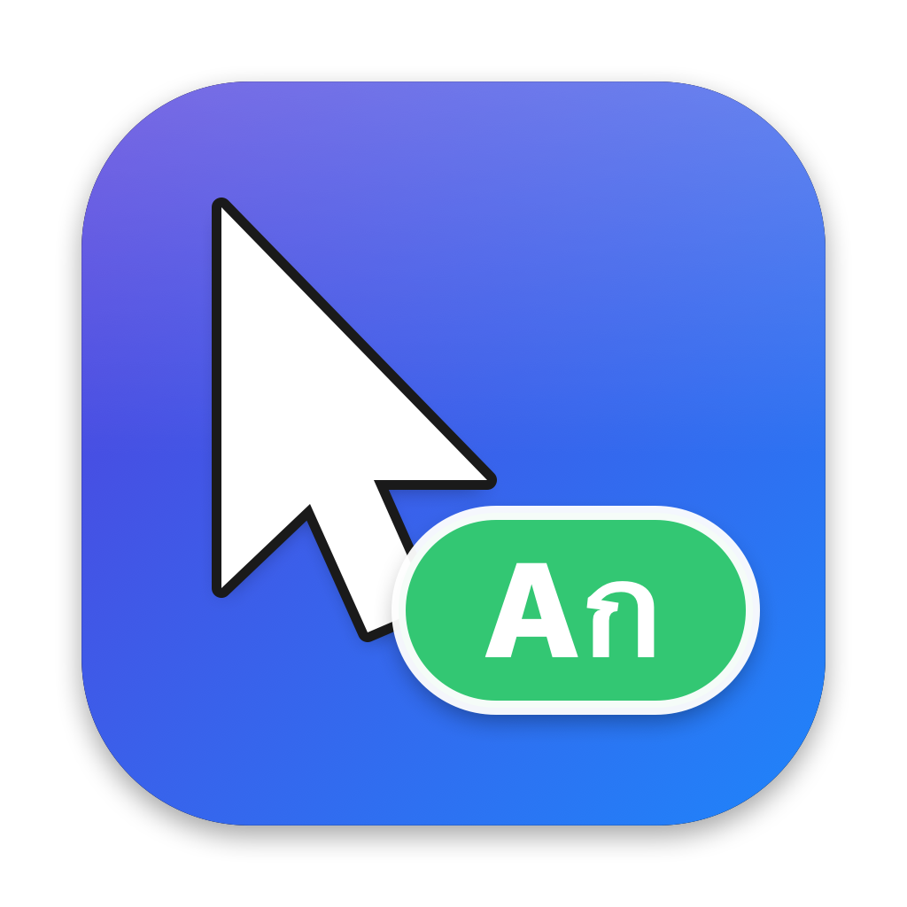
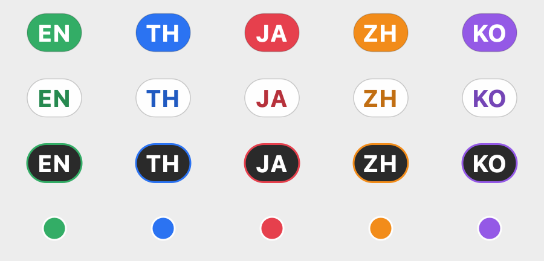
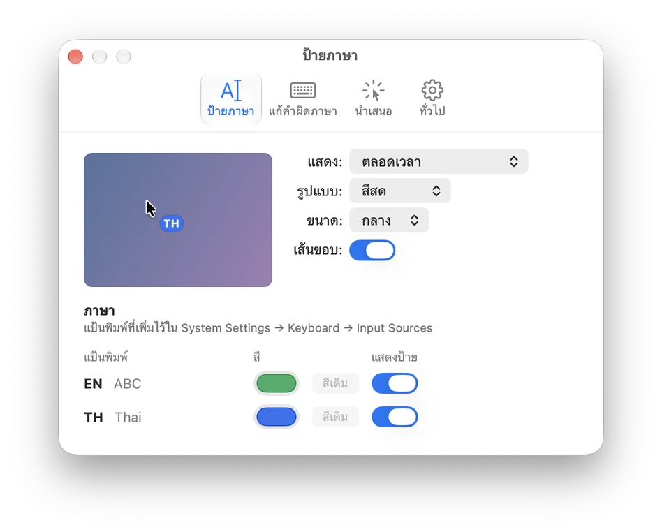
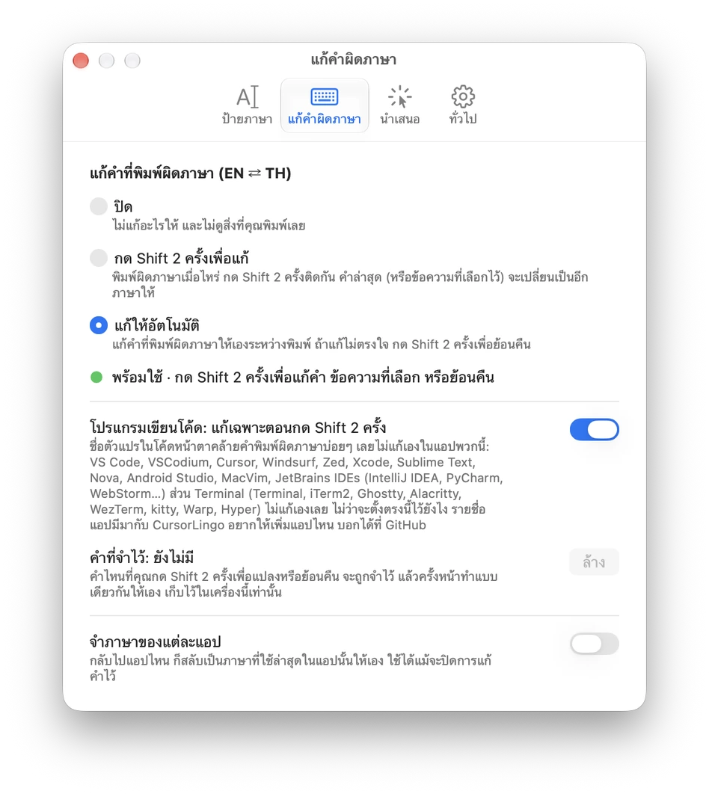
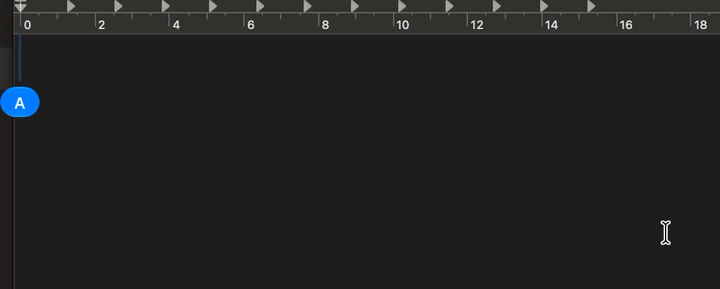
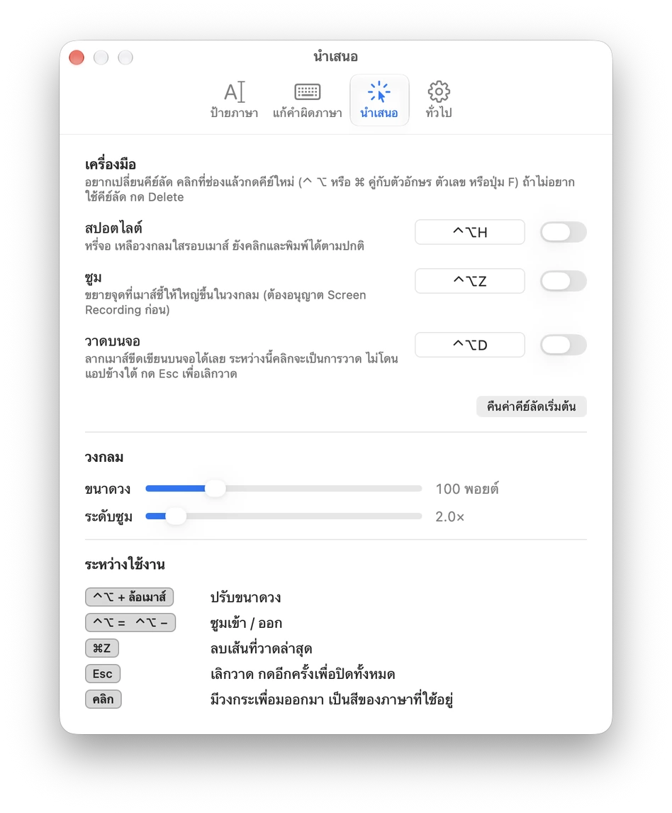

<p align="center">
  
</p>

<h1 align="center">CursorLingo</h1>

<p align="center">
  <a href="README.md">English</a> · <b>ภาษาไทย</b>
</p>

<p align="center">
  แสดงภาษาของแป้นพิมพ์ <b>ที่ตัวชี้เมาส์</b> จะได้ไม่พิมพ์ทั้งประโยคแล้วเพิ่งรู้ว่าลืมเปลี่ยนภาษา<br>
  เล็ก เบา เป็นแอป native และเป็นส่วนตัว ใช้ได้ทั้ง <b>macOS</b> และ <b>Windows</b>
</p>

<p align="center">
  
  <br><sub><a href="assets/demo.mp4">▶ ดูแบบ HD (MP4)</a></sub>
</p>

<p align="center">
  
</p>

## ความสามารถ

- **ป้ายภาษาที่ตัวชี้เมาส์** แสดง `EN`, `TH`, `JA`, `ZH`, `KO`… ได้ทุกภาษา แต่ละภาษามีสีของตัวเอง
- **4 สไตล์** (สีสด · โทนสว่าง · โทนมืด · จุดเล็ก) **3 ขนาด** และมีเส้นขอบบางๆ ที่ปิดได้
- **โหมดการแสดง:** แสดงตลอด หรือแสดงเฉพาะตอนสลับภาษา (โผล่ราว 1 วินาทีแล้วจางหายไป)
- **ตั้งแยกตามภาษา:** เลือกสีเองได้ หรือซ่อนป้ายของภาษานั้น เช่น ให้แสดงป้ายเฉพาะตอนที่ไม่ได้อยู่ในภาษาอังกฤษ หน้าตั้งค่าจะแสดงเฉพาะแป้นพิมพ์ที่คุณเพิ่มไว้ในระบบ
- **เครื่องมือนำเสนอ** สำหรับแชร์จอหรืออัดวิดีโอ ใช้ทีละอย่างหรือพร้อมกันก็ได้ ทุกครั้งที่คลิกจะมีวงคลื่นเป็นสีตามภาษาที่ใช้อยู่
  - **สปอตไลต์** (⌃⌥H บน macOS, Ctrl+Alt+H บน Windows) แบบเดียวกับ [cursor-highlight](https://github.com/Hazyzh/cursor-highlight): จอจะมืดลง เหลือวงกลมใสรอบเมาส์ที่มีขอบสีรุ้งหมุนอยู่ ยังคลิกใช้งานแอปข้างใต้ได้ตามปกติ
  - **ซูม** (⌃⌥Z / Ctrl+Alt+Z): ขยายสิ่งที่อยู่ใต้เมาส์ในวงกลม กด ⌃⌥= และ ⌃⌥− (Ctrl+Alt+= / −) เพื่อซูมเข้าออก ได้ตั้งแต่ 1.5 ถึง 8 เท่า
  - **วาดบนจอ** (⌃⌥D / Ctrl+Alt+D): ลากเมาส์เพื่อวาด กด ⌘Z / Ctrl+Z เพื่อลบเส้นล่าสุด ระหว่างวาด การคลิกจะเป็นการวาดแทน
  - กด ⌃⌥ / Ctrl+Alt ค้างแล้วหมุนล้อเมาส์เพื่อปรับขนาดวง กด Esc ครั้งแรกเพื่อเลิกวาด ครั้งต่อไปเพื่อปิดทั้งหมด
  - เปลี่ยนคีย์ลัดของทั้งสามเครื่องมือได้ที่ **ตั้งค่า → นำเสนอ**
  - สปอตไลต์กับการวาดไม่ต้องขอสิทธิ์อะไร ซูมบน Windows ก็ไม่ต้อง ส่วนซูมบน macOS ต้องได้สิทธิ์ **Screen Recording** เพราะต้องเห็นภาพบนจอ macOS จะถามตอนเปิดซูมครั้งแรก และ macOS รุ่นใหม่จะถามยืนยันซ้ำเป็นระยะ เหมือนกับทุกแอปที่อ่านภาพหน้าจอ
- **จำภาษาแยกตามแอป** (ไม่บังคับ): สลับกลับไปแอปไหน แป้นก็กลับเป็นภาษาที่ใช้ล่าสุดในแอปนั้น เช่น editor เป็นอังกฤษ แชตเป็นไทย
- **หน้าต่างตั้งค่าเดียว** แบ่งเป็น 4 แท็บ: ป้ายภาษา แก้คำผิดภาษา นำเสนอ และทั่วไป ส่วนเมนูบนแถบเมนูหรือใน tray เก็บไว้แค่ของที่ใช้บ่อย คือเครื่องมือนำเสนอกับโหมดแก้คำ
- **เปิด CursorLingo อัตโนมัติ** ตอนเปิดเครื่อง ตั้งได้ในหน้าตั้งค่า
- **ภาษาไทยหรืออังกฤษ** ตามภาษาของระบบ หรือเลือกเองที่ *Language / ภาษา*
- **ไม่บังการคลิก** ป้ายไม่แย่งคลิกหรือโฟกัสจากแอปอื่น
- **แก้คำที่พิมพ์ผิดภาษาอัตโนมัติ** (ไม่บังคับ ปิดไว้เป็นค่าเริ่มต้น): ถ้าพิมพ์ได้ `l;ylfu;yoouhgik` ทั้งที่ตั้งใจพิมพ์ `สวัสดีวันนี้เรา` หรือได้ `ะ้รห` ทั้งที่ตั้งใจพิมพ์ `this` CursorLingo จะพิมพ์คำนั้นใหม่และสลับแป้นให้ รองรับอังกฤษ ⇄ ไทย ดู[รายละเอียด](#แก้คำที่พิมพ์ผิดภาษาอัตโนมัติ)
- **เป็นส่วนตัว** ไม่ใช้อินเทอร์เน็ต ไม่เก็บสถิติ ระบบจะเห็นการพิมพ์ก็ต่อเมื่อเปิด Auto-fix เท่านั้น และเก็บไว้แค่คำปัจจุบันกับคำล่าสุดในหน่วยความจำ รวมถึงรายการคำที่สอนเองด้วย Shift สองครั้ง
- **กินทรัพยากรน้อย** บน macOS ทำงานตามเหตุการณ์ ไม่มีการวนเช็กเป็นระยะ

|                    | macOS                                  | Windows                                        |
|--------------------|----------------------------------------|------------------------------------------------|
| เทคโนโลยี          | Swift + AppKit ไฟล์เดียว               | C++ / Win32 + GDI ไฟล์เดียว เป็น exe แบบ static |
| ติดตามเมาส์        | `NSEvent` global mouse monitor         | low-level mouse hook                           |
| อ่านภาษาจาก        | `kTISNotifySelectedKeyboardInputSourceChanged` | `GetKeyboardLayout` ของหน้าต่างที่โฟกัส |
| หน่วยความจำ        | ราว 15 MB                              | ราว 1–2 MB                                     |
| CPU ตอนว่าง        | 0 %                                    | เกือบ 0 % (เช็กทุก 200 ms แบบรวมรอบ)          |
| ตั้งค่าที่          | หน้าต่างตั้งค่า เปิดจากไอคอนบนแถบเมนู  | หน้าต่างตั้งค่า เปิดจากไอคอนใน tray            |

บน Windows ไอคอนใน tray จะแสดงรหัสภาษาปัจจุบันด้วย และป้ายจะซ่อนเองเมื่อเปิดแอปหรือเกมแบบเต็มจอ

<p align="center">
  <picture>
    <source media="(prefers-color-scheme: dark)" srcset="assets/settings-badge-th-dark.webp">
    
  </picture>
</p>

## ติดตั้ง

### macOS (12 Monterey ขึ้นไป ทั้ง Apple Silicon และ Intel)

ดาวน์โหลด `CursorLingo-macOS.zip` จาก [Releases](https://github.com/kittipongint/cursor-lingo/releases) แตกไฟล์ ย้าย **CursorLingo.app** ไปไว้ที่ **Applications** แล้วดับเบิลคลิกเปิดได้เลย ตั้งแต่ v1.1.4 แอปเซ็นด้วย Developer ID และผ่าน notarization ของ Apple แล้ว จึงเปิดได้โดยไม่มีคำเตือน

ถ้าใช้แค่ป้ายภาษา ไม่ต้องให้สิทธิ์อะไรเพิ่ม สิทธิ์ Input Monitoring และ Accessibility ใช้เฉพาะ [Auto-fix](#เปิด-auto-fix-บน-macos) และ Screen Recording ใช้เฉพาะการซูมในเครื่องมือนำเสนอ

**หรือ build เอง** (ต้องมี Xcode Command Line Tools):

```bash
git clone https://github.com/kittipongint/cursor-lingo.git && cd cursor-lingo && ./install.sh
```

ถ้าใน Keychain มีใบรับรอง *Developer ID Application* อยู่ `install.sh` จะใช้ใบนั้นเซ็นให้ macOS จะจำสิทธิ์ของ CursorLingo ไว้แม้ build ใหม่ ถ้าจะ notarize เอง ดูได้ที่ `macos/notarize.sh`

#### เปิด Auto-fix บน macOS

1. เปิด **ตั้งค่า… → แก้คำผิดภาษา** (หรือเมนูย่อย **แก้คำที่พิมพ์ผิดภาษา (EN ⇄ TH)** บนแถบเมนู) แล้วเลือก **แก้ให้อัตโนมัติ** (หรือ **กด Shift 2 ครั้งเพื่อแก้**) บรรทัดสถานะใต้ตัวเลือกจะบอกว่ายังขาดสิทธิ์อะไร
2. **Input Monitoring:** กดอนุญาตเมื่อ macOS ถาม หรือกด **เปิด Privacy & Security…** ข้างบรรทัดสถานะ แล้วเปิดสวิตช์ CursorLingo ใน **Privacy & Security → Input Monitoring**
3. **Accessibility:** ทำแบบเดียวกันใน **Privacy & Security → Accessibility** ถ้าไม่มี CursorLingo ในรายการ ให้กด **+** แล้วเลือก **Applications → CursorLingo**
4. **Quit CursorLingo แล้วเปิดใหม่** เพราะแอปอ่านสิทธิ์ตอนเริ่มทำงาน
5. บรรทัดสถานะควรขึ้นว่า **พร้อมใช้** ลองทดสอบโดยเปลี่ยนแป้นเป็นอังกฤษ พิมพ์ `l;ylfu` แล้วกด Space ควรได้ **สวัสดี**

   <picture>
       <source media="(prefers-color-scheme: dark)" srcset="assets/settings-fix-th-dark.webp">
       
     </picture>

ทำแค่ครั้งเดียว อัปเดตเวอร์ชันต่อๆ ไป macOS จะจำสิทธิ์ไว้ให้

**อัปเดตมาจาก v1.1.3 หรือเก่ากว่า?** เวอร์ชันเก่าเซ็นแบบ ad-hoc macOS จึงมองว่า v1.1.4 เป็นแอปใหม่ ต้องให้สิทธิ์อีกครั้งเป็นครั้งสุดท้าย: ใน **Input Monitoring** และ **Accessibility** ให้เลือก CursorLingo ตัวเก่า กด **−** แล้วกด **+** เพิ่มตัวใหม่ และเปิดแอปใหม่ ถ้ายังขึ้นว่า *Needs … permission* ให้ล้างรายการเก่าแล้วให้ macOS ถามใหม่:

```bash
tccutil reset Accessibility io.github.cursorlingo
```

```bash
tccutil reset ListenEvent io.github.cursorlingo
```

จากนั้นเปิด CursorLingo ใหม่ แล้วตั้งการแก้คำผิดภาษาเป็น **ปิด** แล้วเปิดกลับอีกครั้ง (ถ้า build เองแบบ ad-hoc จะเป็นเหมือนเวอร์ชันเก่า คือ macOS จะถามสิทธิ์ใหม่ทุกครั้งที่ build)

### Windows 10 / 11 (x64)

ดาวน์โหลดจาก [Releases](https://github.com/kittipongint/cursor-lingo/releases) เลือกได้สองแบบ **ทั้งสองแบบไม่ต้องใช้สิทธิ์ admin**

- **ตัวติดตั้ง (แนะนำ):** `CursorLingo-Windows-x64-Setup.exe` ติดตั้งเฉพาะผู้ใช้คนนี้ไว้ที่ `%LOCALAPPDATA%\Programs\CursorLingo` (แบบเดียวกับ user installer ของ VS Code) สร้าง shortcut ใน Start Menu เลือกให้เปิดพร้อม Windows ได้ และมีรายชื่อใน **Settings → Apps → Installed apps** ให้ถอนการติดตั้งจากตรงนั้นได้ ถอนแล้วค่าตั้งค่าจะถูกลบไปด้วย
- **แบบพกพา (portable):** `CursorLingo-Windows-x64-Portable.zip` แตกไฟล์ไว้ที่ไหนก็ได้ เช่น Desktop หรือ USB แล้วเปิด `CursorLingo.exe` ค่าตั้งค่าเก็บในไฟล์ `CursorLingo.ini` ข้างๆ ย้ายทั้งโฟลเดอร์ไปเครื่องอื่นได้เลย ถ้าจะลบ ปิดแอปแล้วลบโฟลเดอร์ทิ้ง

ค่าตั้งค่าเป็นไฟล์ธรรมดา (ตัวติดตั้งเก็บที่ `%APPDATA%\CursorLingo` ส่วนแบบพกพาเก็บในโฟลเดอร์ของมันเอง) และการเปิด CursorLingo อัตโนมัติเป็นแค่ shortcut ในโฟลเดอร์ Startup registry ที่ถูกเขียนมีแค่ key เดียวที่ตัวติดตั้งต้องใช้ให้แอปขึ้นในรายการ Installed apps ส่วนแบบพกพาไม่เขียน registry เลย

**คำเตือน SmartScreen:** ไฟล์ยังไม่ได้เซ็น (code signing) ครั้งแรก Windows จึงอาจขึ้นว่า *"Windows protected your PC"* แก้ได้สองแบบ:

- **ก่อนเปิดไฟล์:** คลิกขวาที่ไฟล์ที่ดาวน์โหลดมา → **Properties** → ติ๊ก **Unblock** → **OK**
- **หรือตอนที่คำเตือนขึ้น:** กด **More info → Run anyway** Windows จะจำไฟล์นี้ไว้

SmartScreen มองแต่ละเวอร์ชันเป็นไฟล์ใหม่ จึงอาจเจอคำเตือนนี้หนึ่งครั้งทุกครั้งที่อัปเดต

**หรือ build เอง** ด้วย Visual Studio 2022 หรือ Build Tools + CMake:

```bat
windows\build.bat
```

วิธี cross-compile ด้วย MinGW-w64 ดูได้ใน [README ภาษาอังกฤษ](README.md#windows-10--11-x64)

## แก้คำที่พิมพ์ผิดภาษาอัตโนมัติ

<p align="center">
  
</p>

<p align="center"><sub>
  ① พิมพ์ไทยตอนแป้นเป็นอังกฤษ → แก้ระหว่างพิมพ์ &nbsp;·&nbsp;
  ② พิมพ์อังกฤษตอนแป้นเป็นไทย → แก้ตอนกด Space &nbsp;·&nbsp;
  ③ <code>muj</code> + Shift สองครั้ง → ที่ &nbsp;·&nbsp;
  ④ คลุมข้อความ + Shift สองครั้ง → แปลงทั้งบรรทัด
</sub></p>

ที่ **ตั้งค่า → แก้คำผิดภาษา** (หรือในเมนู) เลือก **แก้ให้อัตโนมัติ** เมื่อพิมพ์คำเสร็จแล้วกด Space ถ้าคำนั้นดูไม่เป็นภาษาในแป้นปัจจุบัน แต่เป็นคำจริงในอีกภาษา CursorLingo จะลบคำนั้น พิมพ์ใหม่จากปุ่มชุดเดิม และสลับแป้นให้พิมพ์ต่อได้เลย ถ้าพิมพ์ภาษาไทยยาวๆ ติดกันไม่เว้นวรรค ระบบจะแก้ให้ตั้งแต่ราวตัวอักษรที่ 6

### เลือกได้ว่าจะให้ช่วยแค่ไหน

**แก้คำที่พิมพ์ผิดภาษา (EN ⇄ TH)** เลือกได้ 3 โหมด:

- **ปิด**: ไม่ดักแป้นพิมพ์เลย ใช้แค่ป้ายบอกภาษา
- **กด Shift 2 ครั้งเพื่อแก้**: ไม่เปลี่ยนอะไรเอง แปลงคำหรือข้อความที่คลุมเฉพาะตอนกด Shift สองครั้ง
- **แก้ให้อัตโนมัติ**: แก้ให้เองระหว่างพิมพ์ และยังกด Shift สองครั้งเพื่อแปลงหรือย้อนได้

ในแท็บเดียวกันมี **โปรแกรมเขียนโค้ด: แก้เฉพาะตอนกด Shift 2 ครั้ง** (เปิดไว้เป็นค่าเริ่มต้น ใช้กับโหมดแก้ให้อัตโนมัติ): ใน VS Code, Cursor, Zed, Xcode, JetBrains IDE, Sublime Text, Visual Studio และ editor แนวเดียวกัน ชื่อตัวแปรหรือ keyword อาจดูเหมือนคำมั่ว จึงแปลงให้เฉพาะตอนสั่งด้วย Shift สองครั้ง

**รายการคำส่วนตัว (เรียนรู้จากที่สั่งเอง):** ทุกคำที่แปลงหรือย้อนด้วย Shift สองครั้งจะถูกจำไว้ในเครื่องนี้เท่านั้น เช่น พิมพ์ `muj` แล้วกด Shift สองครั้งให้เป็น "ที่" ครั้งต่อไปที่พิมพ์ `muj` ตอนแป้นเป็นอังกฤษ ระบบจะแก้ให้เอง จึงสอนชื่อเฉพาะ ศัพท์ หรือคำแสลงของตัวเองได้ ในแท็บจะบอกจำนวนคำที่จำไว้ และกด **ล้าง** เพื่อลืมทั้งหมดได้ คำที่ไม่ได้กด Shift สองครั้งจะไม่ถูกบันทึกเลย

**จำภาษาของแต่ละแอป** (อยู่ในแท็บเดียวกัน ปิดไว้เป็นค่าเริ่มต้น): สลับแป้นเป็นภาษาที่ใช้ล่าสุดในแอปนั้นทุกครั้งที่สลับกลับไป เช่น editor เป็นอังกฤษ แอปแชตเป็นไทย ไม่ต้องใช้สิทธิ์พิเศษ และใช้ได้แม้ไม่เปิด Auto-fix

ใช้ต่อได้ทันทีหลังเครื่อง sleep, พับจอ, ล็อกหน้าจอ หรือสลับ user เพราะ CursorLingo จะเชื่อมตัวฟังแป้นพิมพ์ใหม่และล้างคำที่ค้างอยู่ จึงไม่มีการ "แก้" คำเก่าหลังปลุกเครื่อง

### กด Shift สองครั้ง: แปลงเองหรือย้อนคืน

- **ทันทีหลังระบบแก้คำให้:** คำจะกลับเป็นแบบที่พิมพ์ไว้ แป้นสลับกลับเป็นภาษาเดิม และ **จำไว้ว่าจะไม่แก้คำนี้อีก**
- **กับคำอื่น** (คำที่กำลังพิมพ์หรือคำล่าสุด): แปลงคำนั้นเป็นอีกภาษา บางคำระบบไม่แก้ให้อัตโนมัติ เพราะเป็นคำอังกฤษจริงด้วย เช่น `ที่` = `muj` และ `ทำไม` = `mew` ให้ใช้วิธีนี้แทน
- **คลุมข้อความแล้วกด Shift สองครั้ง:** แปลงข้อความที่คลุมทั้งหมดได้ ทั้งหลายคำหรือหลายบรรทัด
  - แปลงทีละตัวอักษร โดยดูว่ามาจากปุ่มไหน แล้วใช้ตัวอักษรของปุ่มเดียวกันในอีกภาษา
  - ถ้าข้อความส่วนใหญ่เป็นไทยจะแปลงเป็นอังกฤษ ถ้าไม่ใช่จะแปลงเป็นไทย
  - ตัวที่ไม่อยู่บนแป้น เช่น ช่องว่าง การขึ้นบรรทัดใหม่ และ emoji จะคงไว้เหมือนเดิม
  - บน macOS อ่านข้อความที่คลุมผ่าน Accessibility ส่วนแอปที่ไม่รองรับ รวมถึงทุกแอปบน Windows จะใช้วิธี copy/paste สั้นๆ แล้วคืนค่า clipboard เดิมให้
  - ข้ามแอป Terminal
- **ถ้าไม่ได้คลุมข้อความ:** ใช้ได้กับคำปัจจุบันหรือคำล่าสุดเท่านั้น และต้องยังไม่ได้คลิก กดคีย์ลัด หรือสลับแอป
- **ไม่ไปยุ่งกับ undo history ของแอป**
- **ข้อควรรู้:** JetBrains IDE ใช้ Shift สองครั้งเปิด Search Everywhere อยู่แล้ว

### หลักการตัดสินใจ

แต่ละครั้งที่กดคือการกด *ปุ่มจริง* บนแป้น และปุ่มเดียวกันให้ตัวอักษรต่างกันในแต่ละภาษา คำที่พิมพ์ผิดภาษาจึงคือข้อความที่ถูกต้อง แค่ถูกอ่านผ่านผังแป้นผิดอัน CursorLingo จะอ่านคำเดียวกันออกมาทั้งสองแบบ และแปลงก็ต่อเมื่อ:

1. แบบที่เห็นบนจอไม่น่าเป็นคำในภาษานั้น และ
2. แบบของอีกภาษาน่าจะเป็นคำจริง

- **ฝั่งอังกฤษ** ใช้โมเดล trigram ของตัวอักษร คำจริงจะได้คะแนนดี ส่วนภาษาไทยที่พิมพ์ด้วยแป้นอังกฤษจะมีลำดับตัวอักษรแปลกๆ และมีปุ่มเครื่องหมายอย่าง `; ' , .` แทรกอยู่กลางคำ
- **ฝั่งไทย** ใช้กฎการเขียนภาษาไทย เช่น คำขึ้นต้นด้วยวรรณยุกต์หรือสระหลังไม่ได้ สระต้องอยู่กับพยัญชนะ และสระหน้าต้องตามด้วยพยัญชนะ ภาษาอังกฤษที่พิมพ์ด้วยแป้นไทยจะผิดกฎเหล่านี้เกือบทันที
- **ไม่แตะเลย:** คำสั้นมาก ตัวเลข path URL อีเมล และคำที่ดูเป็นโค้ด เพราะการไม่แก้คำที่ถูกอยู่แล้วสำคัญกว่าการแก้ให้ครบทุกคำ

ทดสอบกับคำอังกฤษและคำไทยจริง ข้อความที่ถูกอยู่แล้วถูกแก้ผิดน้อยกว่า 1 ใน 1,000 ครั้ง และแก้คำที่พิมพ์ผิดภาษาได้ประมาณ 80 % คำที่ไม่แน่ใจจะปล่อยไว้

### ความเป็นส่วนตัวและสิทธิ์

- **ปิดไว้เป็นค่าเริ่มต้น:** ตัวดักแป้นพิมพ์มีอยู่เฉพาะตอนเปิดใช้
- **เก็บน้อยที่สุด:** เก็บแค่คำปัจจุบันกับคำล่าสุดในหน่วยความจำ สิ่งเดียวที่บันทึกลงเครื่องคือรายการคำส่วนตัว (คำที่แปลงหรือย้อนด้วย Shift สองครั้ง) ลบได้ด้วยปุ่ม **ล้าง** ในหน้าตั้งค่า ไม่มีการบันทึก log และไม่ส่งไปที่ไหน
- **macOS:** ต้องใช้สิทธิ์ **Input Monitoring** และ **Accessibility** (ดู[วิธีเปิด Auto-fix บน macOS](#เปิด-auto-fix-บน-macos)) ข้ามช่องรหัสผ่าน (secure input) และแอป Terminal มีบรรทัดบอกสถานะทั้งในเมนูและหน้าตั้งค่า ถ้ายังไม่ได้รับสิทธิ์จะบอกว่าขาดสิทธิ์ไหน
- **Windows:** ไม่ต้องใช้สิทธิ์พิเศษ แต่จะมองไม่เห็นหน้าต่างที่รันเป็น admin ข้ามช่องรหัสผ่านแบบมาตรฐานและหน้าต่าง console
- **แป้นที่รองรับ:** เฉพาะ US English และไทยเกษมณี (Kedmanee) แบบมาตรฐาน แป้นแบบอื่นจะไม่แตะ

## วิธีใช้

### macOS

ไอคอนบนแถบเมนูแสดงภาษาปัจจุบัน เครื่องมือ **นำเสนอ** โหมด **แก้คำที่พิมพ์ผิดภาษา (EN ⇄ TH)** พร้อมสถานะ เมนู **ตั้งค่า…** (⌘,) และปิดแอป หน้าต่าง **ตั้งค่า…** มี 4 แท็บ:

- **ป้ายภาษา:** ตัวอย่างป้ายข้างลูกศรเมาส์ที่เปลี่ยนตามทันที ตั้ง **แสดง** **รูปแบบ** **ขนาด** และ **เส้นขอบ** และมีแถวของแต่ละแป้นพิมพ์ที่เพิ่มไว้ใน System Settings → Keyboard → Input Sources (ไม่มีภาษาอื่นปน) ใช้เลือกสีหรือซ่อนป้ายของภาษานั้น
- **แก้คำผิดภาษา:** เลือกโหมดพร้อมดูสถานะ, **โปรแกรมเขียนโค้ด: แก้เฉพาะตอนกด Shift 2 ครั้ง**, คำที่จำไว้ (กด **ล้าง** เพื่อลืม) และ **จำภาษาของแต่ละแอป**
- **นำเสนอ:** เปิด/ปิดสปอตไลต์ ซูม และวาดบนจอ เปลี่ยนคีย์ลัด ตั้งขนาดวงกับระดับซูม และมีตารางคีย์ที่ใช้ได้ระหว่างเปิดเครื่องมือ
- **ทั่วไป:** **เปิด CursorLingo อัตโนมัติ**, ภาษาของเมนูและหน้าต่าง **Language / ภาษา**, **แจ้งปัญหา…** (เปิดฟอร์มบน GitHub โดยไม่แนบสิ่งที่พิมพ์) เลขเวอร์ชัน และช่องทาง[สนับสนุน](#สนับสนุน)

หน้าต่างตั้งค่าจะลอยอยู่บนหน้าต่างอื่นเสมอ จึงลองปรับค่าแล้วไปดูผลในแอปอื่นได้เลย

<p align="center">
  <picture>
    <source media="(prefers-color-scheme: dark)" srcset="assets/settings-presentation-th-dark.webp">
    
  </picture>
</p>

### Windows

คลิกไอคอนใน tray จะเห็นภาษาปัจจุบัน เครื่องมือ **นำเสนอ** โหมด **แก้คำที่พิมพ์ผิดภาษา (EN ⇄ TH)** เมนู **ตั้งค่า…** และปิดแอป หน้าต่าง **ตั้งค่า…** มี 4 แท็บเหมือนบน macOS:

- **ป้ายภาษา:** ตัวอย่างป้ายที่เปลี่ยนตามทันที ตั้ง **แสดง** **รูปแบบ** **ขนาด** และ **เส้นขอบ** และมีแถวของแต่ละแป้นพิมพ์ที่เพิ่มไว้ใน Settings ของ Windows → Time & language → Language & region ใช้เลือกสีหรือซ่อนป้ายของภาษานั้น
- **แก้คำผิดภาษา:** เลือกโหมด, โปรแกรมเขียนโค้ด: แก้เฉพาะตอนกด Shift 2 ครั้ง, ล้างคำที่จำไว้ และ **จำภาษาของแต่ละแอป**
- **นำเสนอ:** เปิด/ปิดสปอตไลต์ ซูม และวาดบนจอ เปลี่ยนคีย์ลัด และตั้งขนาดวงกับระดับซูม
- **ทั่วไป:** **เปิด CursorLingo อัตโนมัติ** (เวอร์ชันจาก Microsoft Store จะพาไปหน้า Startup apps ของ Windows แทน), ภาษาของเมนูและหน้าต่าง **Language / ภาษา**, **แจ้งปัญหา…** (เปิดฟอร์มบน GitHub โดยไม่แนบสิ่งที่พิมพ์) เลขเวอร์ชัน และช่องทาง[สนับสนุน](#สนับสนุน)

## ถอนการติดตั้ง

- **macOS:** รัน `./uninstall.sh` หรือปิดแอปแล้วลบทิ้ง ให้ปิด *เปิด CursorLingo อัตโนมัติ* (ตั้งค่า → ทั่วไป) ก่อน
- **Windows:** ถ้าใช้ตัวติดตั้ง ไปที่ **Settings → Apps → Installed apps → CursorLingo → Uninstall** (ลบค่าตั้งค่าให้ด้วย) ถ้าใช้แบบพกพา ให้ปิด *เปิด CursorLingo อัตโนมัติ* (ตั้งค่า → ทั่วไป) ปิดแอป แล้วลบโฟลเดอร์ทิ้ง

## ความเป็นส่วนตัว

CursorLingo ไม่เก็บข้อมูลและไม่เชื่อมต่อเครือข่ายเลย อ่านนโยบายฉบับเต็มได้ที่ [PRIVACY.md](PRIVACY.md#นโยบายความเป็นส่วนตัวของ-cursorlingo)

## ร่วมพัฒนา

เจอคำที่ระบบแก้ผิด หรือพิมพ์ผิดภาษาแล้วไม่แก้ให้? นี่คือรายงานที่มีประโยชน์ที่สุด แจ้งผ่าน[ฟอร์มแจ้งคำที่แก้ผิด](https://github.com/kittipongint/cursor-lingo/issues/new/choose) (เขียนภาษาไทยได้) หรือเพิ่มบรรทัดใน [`tests/cases.tsv`](tests/cases.tsv) แล้วเปิด pull request วิธีทดสอบคำ วิธี build และกติกาเรื่องความเป็นส่วนตัวอยู่ใน [CONTRIBUTING.md](CONTRIBUTING.md) ส่วนปัญหาด้านความปลอดภัยหรือความเป็นส่วนตัว ดู [SECURITY.md](SECURITY.md)

## สนับสนุน

CursorLingo แจกฟรี และทำในเวลาว่าง ถ้ามันช่วยคุณได้ กดดาว ⭐ บน GitHub แชร์ให้เพื่อนๆ หรือเลี้ยงกาแฟสักแก้ว ก็ช่วยให้โปรเจกต์ไปต่อได้นะ

- **Ko-fi:** [ko-fi.com/kintstudio](https://ko-fi.com/kintstudio)
- **พร้อมเพย์:** 080-478-2843 หรือสแกน QR ด้วยแอปธนาคาร แล้วใส่จำนวนเงินเท่าไหร่ก็ได้


ทั้งสองช่องทางมีในแอปด้วย ที่ **ตั้งค่า → ทั่วไป**

## โปรเจกต์ที่เกี่ยวข้อง

- **[RightLang](http://blog.rightlang.com/)** เครื่องมือของคนไทยที่ใช้แก้คำพิมพ์ผิดภาษามานาน

## สำหรับนักพัฒนา

โครงสร้างโปรเจกต์ การสร้างไอคอน และรายละเอียดทางเทคนิคอื่นๆ ดูได้ใน [README ภาษาอังกฤษ](README.md#project-layout)

## License

[MIT](LICENSE)
